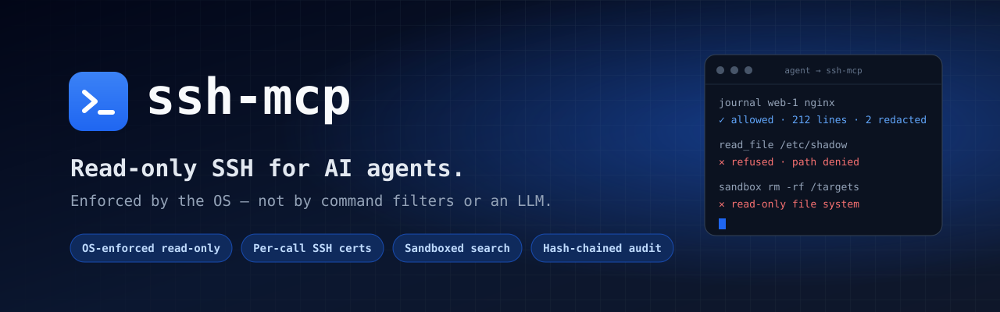
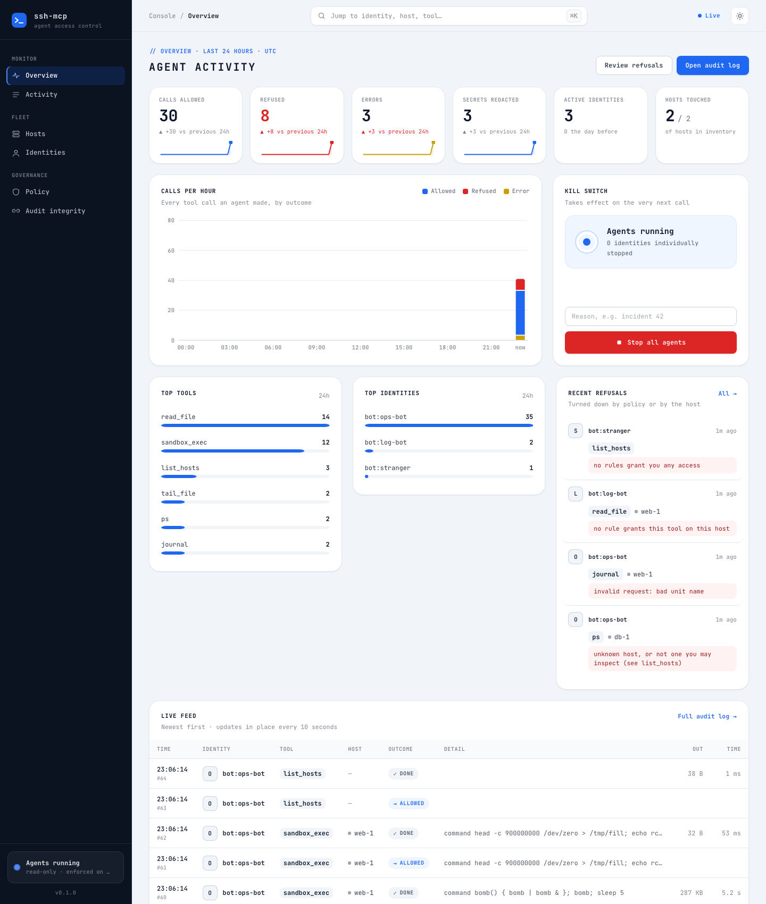
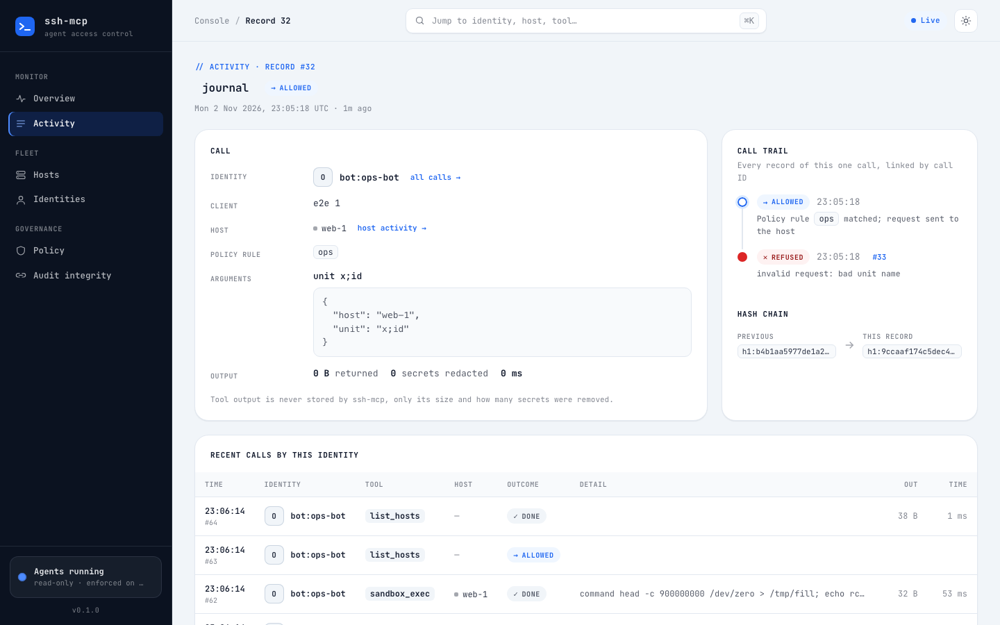
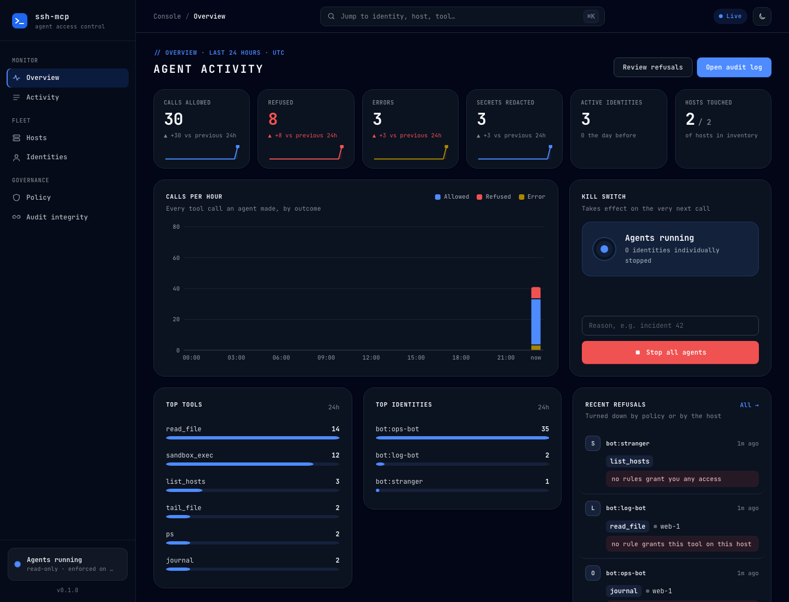

<p align="center">
  
</p>

<p align="center">
  <a href="https://github.com/nguyencongnamit/ssh-mcp/actions/workflows/ci.yml"></a>
  <a href="https://github.com/nguyencongnamit/ssh-mcp/actions/workflows/e2e.yml"></a>
  <a href="https://github.com/nguyencongnamit/ssh-mcp/actions/workflows/codeql.yml"></a>
  <a href="https://scorecard.dev/viewer/?uri=github.com/nguyencongnamit/ssh-mcp"></a>
  <a href="https://github.com/nguyencongnamit/ssh-mcp/releases/latest"></a>
  <a href="go.mod"></a>
  <a href="LICENSE"></a>
</p>

<p align="center">
  <b>Let AI agents diagnose your servers without being able to change them.</b><br>
  <a href="docs/quickstart.md">Quick start</a> ·
  <a href="docs/architecture.md">Architecture</a> ·
  <a href="docs/threat-model.md">Threat model</a> ·
  <a href="docs/deployment.md">Deploy</a> ·
  <a href="docs/console.md">Console</a> ·
  <a href="ROADMAP.md">Roadmap</a>
</p>

---

**ssh-mcp** is a [Model Context Protocol](https://modelcontextprotocol.io)
server that gives agents such as Claude Code, Claude Desktop or your own bots
**read-only** access to Linux hosts: logs, configs, processes, sockets, disk
and systemd. Read-only is enforced by the target's operating system, not by
filtering commands or asking an LLM to behave.

## Why

Giving an agent a normal SSH key gives it a shell. Command allowlists lose to
[GTFOBins](https://gtfobins.github.io) (`less` → `!sh`, `find -exec`,
`awk 'BEGIN{system(…)}'`). An LLM reviewer can be prompt-injected by the very
log line it is reviewing. Cloud "run command" APIs usually run as root.

ssh-mcp takes a different approach: **there is no path to a shell at all.**

| Agent asks to… | What happens |
|---|---|
| Read nginx's journal on `web-1` | ✅ Allowed by policy → fixed `journalctl` argv on the host → secrets redacted → returned |
| `grep -r ERROR` across `/var/log` | ✅ Runs in a no-network sandbox over a read-only mirror |
| Read `/etc/shadow` or `**/.env` | ❌ Denied on the server **and** on the host, even through the sandbox |
| `rm`, `kill`, `systemctl restart` | ❌ No such tool. The host user has no rights, and the mirror is read-only |
| Inject `unit="x; id"` | ❌ Rejected by schema validation in the helper; there is no shell to inject into |
| Reach a host outside its policy | ❌ Not listed, not reachable, and audited |

## How it stays read-only

Seven layers. The first four are the hard boundary and hold even if
everything above them fails.

| # | Layer | Enforced by | Guarantee |
|---|---|---|---|
| 1 | `agent-ro` / `agent-sftp` users | Linux | non-root, no sudo, no usable password |
| 2 | Per-call SSH certificate + `Match User` | sshd | forced helper, no pty, no forwarding, 5-minute TTL, pinned source |
| 3 | `ssh-mcp-helper` | fixed `execve`, no shell | typed tools only; symlink-safe reads; path policy = host floor ∩ policy **signed into the certificate** |
| 4 | bubblewrap sandbox | namespaces + cgroup v2 | free-form search with no network, no capabilities, capped pids and memory |
| 5 | Transport | AWS IAM + SSM | `AWS-StartSSHSession` only, tagged hosts only, port 22 closed (direct SSH also supported) |
| 6 | Policy | ssh-mcp server | who × host tags × tool, rate limits, deny by default, kill switch |
| 7 | Output | ssh-mcp server | size cap, secret redaction, untrusted-data fence, hash-chained audit |

<picture>
  <source media="(prefers-color-scheme: dark)" srcset="docs/assets/architecture-dark.svg">
  
</picture>

Details: [architecture](docs/architecture.md) · [threat model](docs/threat-model.md)

## Quick start (local, no cloud account)

```sh
git clone https://github.com/nguyencongnamit/ssh-mcp && cd ssh-mcp
make test          # unit tests with the race detector
./testbed/up.sh    # a real Linux target + the server, in Docker
make e2e           # end-to-end suite that attacks both

claude mcp add --transport http ssh-mcp http://127.0.0.1:18471/mcp \
  --header "Authorization: Bearer $(cat testbed/state/ops-bot.token)"
```

Then ask your agent: *"Which services failed on web-1, and why?"*
More in the [quick start](docs/quickstart.md).

## Tools

| Tool | What it returns |
|---|---|
| `list_hosts` | hosts your policy grants |
| `host_overview` | kernel, uptime, memory, disk, CPUs |
| `ps` | top processes (command lines redacted) |
| `listening_ports` | listening sockets |
| `journal` | systemd journal by unit, time window and priority |
| `systemctl_status`, `failed_units` | unit state |
| `read_file`, `tail_file`, `list_dir` | files under allowed paths |
| `sandbox_exec` | `grep` / `awk` / `find` / `jq` over a read-only mirror, no network |

No tool sends a raw command to a target. Full reference: [docs/tools.md](docs/tools.md).

## Admin console

Built into the binary, on its own listener: live activity, refusals, per-call
trail with its hash-chain link, hosts, identities with a kill switch, policy
view and audit verification. Strict CSP, CSRF-protected, and every action is
audited.

<p align="center">
  
</p>

<table>
  <tr>
    <td></td>
    <td></td>
  </tr>
  <tr>
    <td align="center"><sub>Call trail: an injection attempt stopped on the host</sub></td>
    <td align="center"><sub>Dark theme</sub></td>
  </tr>
</table>

## Operate

```sh
ssh-mcp token create -name triage-bot -owner ops -ttl 720h   # shown once, stored hashed
ssh-mcp kill -identity bot:triage-bot -reason "incident 42"  # the next call is refused
ssh-mcp kill -all -reason "stop everything"
ssh-mcp audit verify                                         # check the hash chain
ssh-mcp policy check -config /etc/ssh-mcp/ssh-mcp.yaml
```

Production setup (server, IAM, target bootstrap, console over port
forwarding): [docs/deployment.md](docs/deployment.md) ·
[configuration](docs/configuration.md).

## Quality and supply chain

| | |
|---|---|
| Tests | 63 unit/integration tests (race detector), 3 fuzz targets in CI, and 12 end-to-end suites against real OpenSSH targets on five distributions, including direct attacks on sshd, fork and memory bombs, and an encoding-bypass regression |
| Security review | 13 findings from a pre-release adversarial review, all fixed ([threat model](docs/threat-model.md#independent-review)) |
| CI | gofmt, vet, coverage floor on boundary packages, govulncheck, ShellCheck, CodeQL, OpenSSF Scorecard |
| Releases | reproducible builds (rebuilt and diffed in CI), `SHA256SUMS`, CycloneDX SBOM, SLSA build provenance (`gh attestation verify`) |

## Status

**ssh-mcp is a public preview.** Every pull request runs the end-to-end
attack suite against Ubuntu 22.04, 24.04 and 26.04, Debian 12 and Amazon
Linux 2023 targets, but it has not yet been run on a production fleet. Read the [known limits](docs/threat-model.md#known-limits)
before you deploy, especially: secret redaction is a filter, so fix
permissions on world-readable secrets.

## License

ssh-mcp is **source-available** under the [Business Source License 1.1](LICENSE).

- **Free** for individuals, non-profits, education and research, and for any
  evaluation, development, testing or other non-production use.
- **Production use by or for a for-profit organization, including internal
  use, needs a commercial license.**
- Each version **automatically becomes Apache-2.0 three years after its
  release** (v0.1.0 → 2029-11-03).

See the [licensing FAQ](docs/licensing.md). For a commercial license, contact
[@nguyencongnamit](https://github.com/nguyencongnamit).

## Contributing

Issues and pull requests are welcome. Read [CONTRIBUTING.md](CONTRIBUTING.md);
contributions are accepted under the [CLA](CLA.md). Report vulnerabilities
privately, as described in [SECURITY.md](SECURITY.md).
