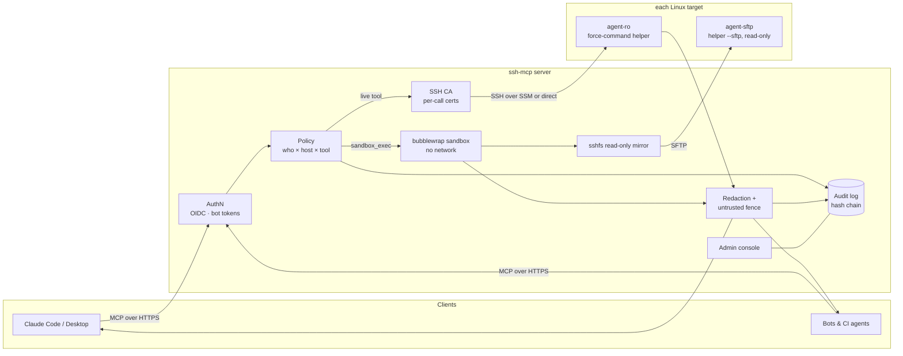

# Architecture

ssh-mcp is one central server that AI agents talk to over the
[Model Context Protocol](https://modelcontextprotocol.io). It holds every
sensitive part: the SSH certificate authority, the policy and the audit log.
Targets trust only its short-lived certificates, and only as two read-only
users.

## Two tool paths

| Path | Used by | Runs where | Enforced by |
|---|---|---|---|
| **Live** | `host_overview`, `ps`, `listening_ports`, `journal`, `systemctl_status`, `failed_units`, `read_file`, `tail_file`, `list_dir` | on the target, as `agent-ro` | `ssh-mcp-helper`: fixed `execve` per tool, no shell |
| **Sandbox** | `sandbox_exec` (free-form `grep`, `awk`, `find`, `jq`) | on the server, inside bubblewrap | read-only sshfs mirror served by `ssh-mcp-helper --sftp` as `agent-sftp` |

No tool sends a raw command string to a target.

## Life of a call

1. **Authenticate.** A bearer token is either an OIDC access token (people,
   keyed on tenant + object ID) or a hashed `smcp_` bot token.
2. **Kill switch.** A disabled identity, or a global stop, is refused first.
3. **Policy.** Deny by default; a rule must match the caller, the host's tags
   and the tool. Rate limits apply per rule.
4. **Audit `allow`/`deny`.** Every decision is appended to a hash-chained,
   optionally HMAC-keyed SQLite log with a call ID.
5. **Issue a certificate.** Ed25519, 5 minutes (live) or 15 minutes (mirror),
   principal `ssh-mcp-live` or `ssh-mcp-sftp`, `force-command` pinned, no
   `permit-*` extensions, `source-address` pinned, and the effective path
   policy embedded as the `ssh-mcp-paths@ssh-mcp` extension.
6. **Transport.** SSH over AWS SSM `AWS-StartSSHSession` (no inbound port 22),
   or direct SSH for non-AWS hosts.
7. **On the target.** sshd's `Match User` block forces the helper again.
   The helper refuses to run as root, re-verifies the certificate's CA from
   `SSH_USER_AUTH`, intersects the signed path policy with the host's own
   floor policy, and runs one fixed argv with a fixed environment and timeout.
8. **Output.** Capped, passed through the redaction filter, wrapped in an
   untrusted-data fence, and returned. Only size and redaction count are
   audited; output is never stored.

## Components

| Package | Responsibility |
|---|---|
| `cmd/ssh-mcp` | server and admin CLI (`serve`, `ca`, `token`, `kill`, `audit`, `policy`, `console`) |
| `cmd/ssh-mcp-helper` | installed on targets; live mode and `--sftp` mode |
| `internal/helper` | target boundary: tools, `secureOpen` (symlink/FIFO safe), read-only SFTP, cert policy |
| `internal/server` | MCP tools and the call pipeline |
| `internal/policy`, `internal/pathpolicy` | rules, rate limits, path allow/deny with `**/` globs |
| `internal/ca` | certificate issuance |
| `internal/transport`, `internal/live` | SSM and direct transports, SSH client |
| `internal/sandbox` | bubblewrap runner, mirror manager, cgroup v2 limits |
| `internal/redact` | secret patterns + entropy pass |
| `internal/store` | audit chain, kill switch, bot tokens, queries |
| `internal/authn`, `internal/identity` | OIDC and token auth, identity keys |
| `internal/console` | server-rendered admin UI |

See [threat-model.md](threat-model.md) for what each layer defends against.
