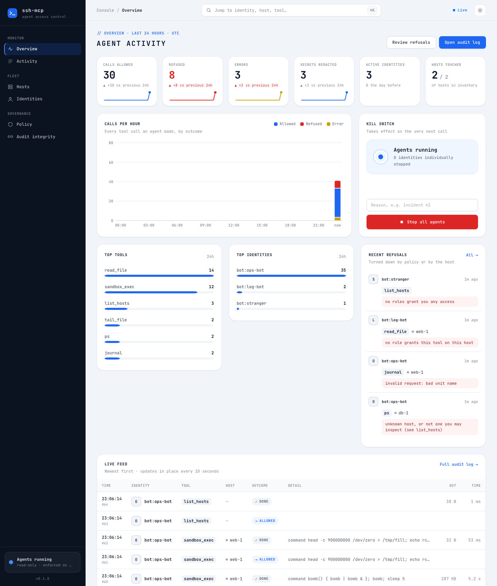

# Admin console

A web console is built into the `ssh-mcp` binary and served on its own
listener, separate from the agent endpoint.



| Page | Shows |
|---|---|
| Overview | 24-hour KPIs with sparklines and change vs the previous day, calls per hour by outcome, kill switch, top tools and identities, recent refusals, live feed |
| Activity | filterable audit log; each call's trail (request → decision → result) and its hash-chain link |
| Hosts | inventory with tags, 24-hour activity and the rules that reach each host |
| Identities | every bot and person seen; stop / re-enable; bot tokens with expiry and revoke |
| Policy | each rule as who → tools → hosts, plus readable and always-hidden paths |
| Audit integrity | chain verification and the latest links |

⌘K (or `/`) opens a command palette. Pages refresh in place every 10 seconds.
Light and dark themes.

**Security:** bcrypt Basic auth, strict CSP with no inline script or style,
CSRF token plus same-origin checks on every action, `frame-ancestors 'none'`,
and every console action written to the audit log as `console:<user>`. Tool
output is never stored, so the console only shows sizes and redaction counts.

```yaml
console:
  listen: 127.0.0.1:8444
  user: admin
  password_hash: "$2a$12$..."   # ssh-mcp console passwd
  timezone: UTC
```
